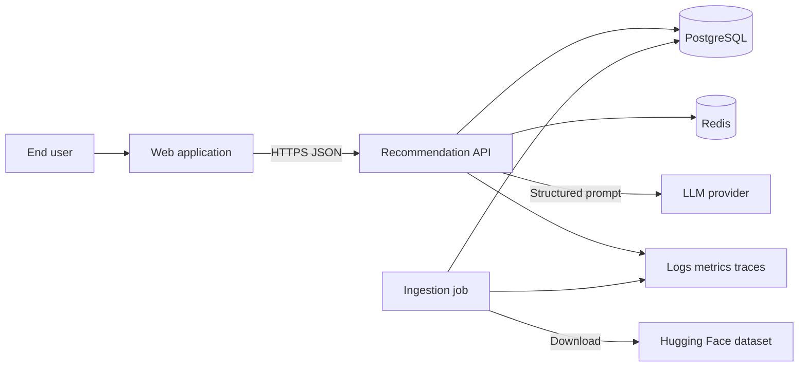
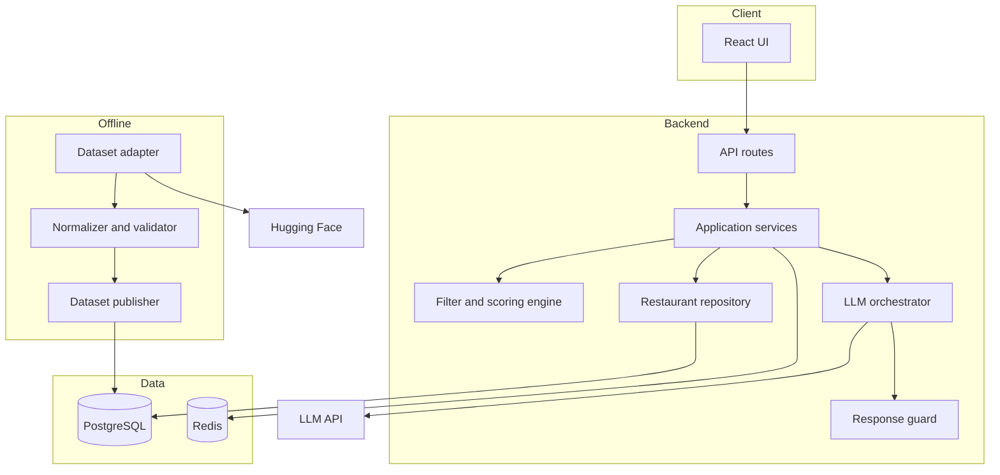
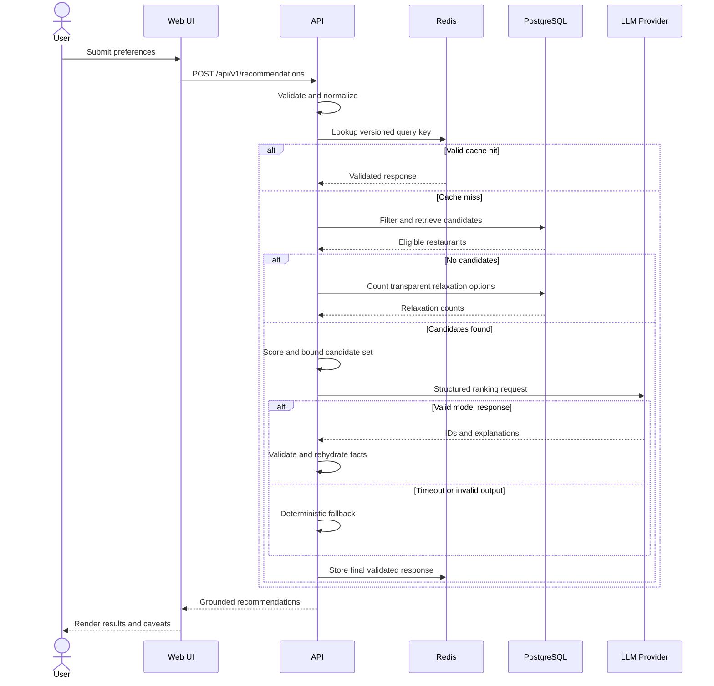
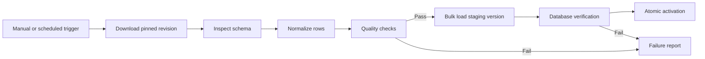

# AI-Powered Restaurant Recommendation System Architecture

## 1. Purpose

This document defines the technical architecture for implementing the AI-powered restaurant recommendation system described in [problemStatement.md](problemStatement.md). It translates the product requirements into deployable components, data models, interfaces, processing flows, security controls, test boundaries, and operational practices.

The architecture is designed around one central rule: structured application code determines which restaurants are eligible, while the Large Language Model (LLM) only ranks and explains a bounded set of eligible candidates. The LLM is never the source of truth for restaurant facts.

## 2. Architecture Goals

The solution must:

- Enforce location, budget, cuisine, rating, and other hard constraints deterministically.
- Ground all restaurant facts in the source dataset.
- Prevent an LLM from introducing unknown restaurants or changing factual fields.
- Remain usable when the LLM provider is slow or unavailable.
- Keep the web client independent of dataset and LLM provider details.
- Support repeatable ingestion, versioned data, and auditable recommendations.
- Minimize prompt size, inference latency, and LLM cost.
- Provide modular boundaries that are straightforward to test and replace.
- Start as a maintainable modular monolith and scale individual workloads only when evidence justifies it.

## 3. Recommended Technology Stack

| Layer | Recommended technology | Rationale |
|---|---|---|
| Web application | React with TypeScript | Typed UI development and a mature component ecosystem |
| API service | Python 3.12 with FastAPI | Strong validation, async I/O, automatic OpenAPI, and compatibility with data tooling |
| Validation | Pydantic | Shared request, domain, and LLM response contracts |
| Dataset ingestion | Hugging Face `datasets`, Polars or pandas | Direct source access and practical tabular transformation |
| Primary datastore | PostgreSQL | Reliable relational filtering, indexing, constraints, and versioned metadata |
| Cache and rate-limit store | Redis | Low-latency result caching, distributed rate limiting, and short-lived locks |
| Background work | FastAPI worker process initially; Celery/RQ only when needed | Avoids premature infrastructure while preserving a migration path |
| LLM integration | Provider-neutral adapter using structured output | Keeps provider selection configurable and testable |
| Database migrations | Alembic | Version-controlled schema evolution |
| Testing | Pytest, Testcontainers, and Playwright | Unit, integration, and browser-level verification |
| Packaging | Docker and Docker Compose | Reproducible local and deployment environments |
| Observability | OpenTelemetry, structured logs, metrics backend | Correlated traces, metrics, and logs without provider lock-in |

These choices are reference defaults, not requirements imposed on consumers. Component interfaces below allow the UI framework, database, cache, and LLM provider to be replaced independently.

## 4. Architectural Style

Use a modular monolith for the initial release. The API, recommendation engine, prompt construction, validation, and repository layer run in one deployable backend service. Dataset ingestion runs as a separate command or worker using the same domain and persistence modules.

This provides clear module boundaries without the operational cost of microservices. If scale later requires separation, the ingestion worker and LLM orchestration module are natural extraction points.

### 4.1 System Context



### 4.2 Container View



## 5. Component Responsibilities

### 5.1 Web Application

The web application is responsible for:

- Collecting structured preferences and optional free-form context.
- Performing basic client-side validation for fast feedback.
- Sending typed requests to the backend.
- Rendering ranked results, factual attributes, explanations, caveats, and relaxation notices.
- Representing loading, no-match, degraded, validation-error, and service-error states.
- Preserving accessibility through semantic controls, keyboard navigation, and screen-reader labels.

The browser must not receive LLM credentials, connect directly to the LLM, download the full dataset, or implement authoritative filtering.

### 5.2 API Layer

The API layer owns transport concerns:

- Request deserialization and schema validation.
- Authentication if introduced later.
- Request ID creation and propagation.
- Rate-limit enforcement.
- Mapping domain outcomes to stable HTTP responses.
- Redaction-safe access logging.
- OpenAPI documentation.

Routes should be thin. Business rules belong in application or domain services.

### 5.3 Preference Normalizer

This component converts API input into a canonical `RecommendationQuery`:

- Trims and case-folds location and cuisine values.
- Maps named budget tiers to versioned numeric ranges.
- Validates rating boundaries against the source scale.
- Deduplicates cuisine selections.
- Applies result-count defaults and limits.
- Treats free-form text as untrusted content.
- Records defaults and interpretations for later disclosure.

Free-form text must not silently become a hard constraint. A future preference-extraction model may produce typed soft preferences, but its interpretation should be returned to the user and logged as structured metadata.

### 5.4 Restaurant Repository

The repository isolates the domain from PostgreSQL. It provides:

- Hard-constraint queries.
- Cuisine and location lookup for input assistance.
- Dataset-version selection.
- Candidate retrieval with a strict upper bound.
- Restaurant lookup by stable ID for response validation.

All user-controlled values must use parameterized queries. Filtering should execute in the database when possible.

### 5.5 Filtering and Scoring Engine

This deterministic component:

1. Enforces every hard constraint.
2. Calculates a transparent preliminary score.
3. Applies stable tie-breakers.
4. Selects a bounded candidate list for the LLM.
5. Produces fallback ordering if LLM generation fails.

The component must be a pure or near-pure domain module so it can be tested without network services.

### 5.6 Recommendation Orchestrator

The orchestrator coordinates a recommendation request:

1. Normalize preferences.
2. Resolve the active dataset version.
3. Check an eligible cached response.
4. Fetch and score candidates.
5. Handle a zero-match result or compute transparent relaxation suggestions.
6. Build a constrained LLM request.
7. Invoke the provider with a deadline.
8. Parse and validate structured output.
9. Rehydrate factual fields from the database.
10. Return an LLM-ranked or deterministic fallback response.

It owns orchestration policy but not SQL, score calculations, provider-specific SDK details, or UI formatting.

### 5.7 Prompt Builder

The prompt builder creates a versioned prompt from typed inputs. It should:

- Separate system instructions, user preferences, and candidate data.
- Serialize candidate records as compact JSON.
- Include stable restaurant IDs rather than relying on names.
- Declare which fields may be used as evidence.
- Require a strict response schema.
- Require caveats for unsupported soft preferences.
- Explicitly forbid new candidates and altered facts.
- Assign a prompt version for evaluation and rollback.

The free-form preference must be delimited as data. Instructions embedded within it must not be followed.

### 5.8 LLM Provider Adapter

Define a provider-neutral interface such as:

```python
class RankingModel(Protocol):
    async def rank(
        self,
        request: RankingRequest,
        *,
        timeout_seconds: float,
    ) -> RankingResult: ...
```

Provider-specific adapters translate the typed request into the provider API and map the result into the internal model. The adapter owns authentication, retryable provider errors, token usage extraction, and provider request IDs. It must not own business validation.

### 5.9 Response Guard

No raw model response may reach the client. The response guard must:

- Parse output against a strict schema.
- Reject duplicate or unknown restaurant IDs.
- Enforce the requested result limit.
- Ensure every result came from the supplied candidate set.
- Discard model-supplied copies of ratings, costs, cuisines, and locations.
- Rehydrate factual fields from trusted candidate records.
- Restrict explanations and caveats to configured lengths.
- Reject or neutralize markup that is unsafe to render.
- trigger one constrained repair attempt for malformed output.
- Fall back to deterministic ordering if validation still fails.

This design makes factual correctness independent of whether the model repeats values accurately.

### 5.10 Ingestion Pipeline

The ingestion path is independent of the online request path. It consists of:

- **Dataset adapter:** downloads a pinned Hugging Face dataset revision and captures source metadata.
- **Schema inspector:** validates required source columns and produces a schema report.
- **Normalizer:** maps raw rows to the canonical restaurant model.
- **Quality validator:** computes invalid, missing, duplicate, and rejected-row counts.
- **Staging writer:** bulk-loads records into version-specific staging tables.
- **Publisher:** atomically marks a validated dataset version active.

An ingestion failure must leave the current active version untouched.

## 6. Data Architecture

### 6.1 Canonical Restaurant Model

The canonical model should contain only verified source or derived normalization fields:

| Field | Type | Notes |
|---|---|---|
| `id` | UUID | Internal stable identifier |
| `source_key` | string | Stable source identifier or derived fingerprint |
| `dataset_version_id` | UUID | Owning immutable dataset version |
| `name` | string | Original display name |
| `name_normalized` | string | Search and deduplication value |
| `city` | string nullable | Original city |
| `city_normalized` | string nullable | Canonical city |
| `locality` | string nullable | Original locality |
| `locality_normalized` | string nullable | Canonical locality |
| `address` | string nullable | Source address if available |
| `cuisines` | string array | Original normalized cuisine labels |
| `average_cost_minor` | integer nullable | Cost in minor currency units |
| `currency_code` | char(3) nullable | ISO currency when known |
| `rating` | decimal nullable | Validated rating |
| `rating_scale` | decimal | Source maximum, such as 5.0 |
| `votes` | integer nullable | Confidence signal when available |
| `attributes` | JSONB | Whitelisted optional source attributes |
| `source_url` | string nullable | Traceability link when available |
| `source_payload_hash` | string | Change and deduplication support |
| `created_at` | timestamp | Ingestion timestamp |

Store cuisines in a normalized junction table for strong query performance if the source volume warrants it. A PostgreSQL array with a GIN index is acceptable for an MVP.

### 6.2 Supporting Tables

#### `dataset_versions`

- `id`
- `source_name`
- `source_revision`
- `schema_version`
- `content_hash`
- `status`: `staging`, `validated`, `active`, `failed`, `retired`
- `record_count`
- `rejected_count`
- `quality_report` JSONB
- `created_at`, `activated_at`

Only one version may be active. Activation must be transactional.

#### `budget_profiles`

- `key`: `low`, `medium`, or `high`
- `currency_code`
- `minimum_minor`
- `maximum_minor`
- `version`

Named budget ranges must be explicit, versioned configuration rather than hidden prompt logic.

#### `recommendation_audits`

Store operational metadata only when privacy policy permits:

- Request ID and timestamps
- Dataset and prompt versions
- Hashed normalized query key
- Candidate and returned restaurant IDs
- Execution mode: `llm`, `fallback`, or `no_match`
- Latency breakdown
- Provider/model identifiers
- Token usage and estimated cost
- Validation or failure codes

Raw free-form user text should be excluded by default.

### 6.3 Indexing

Recommended indexes include:

- B-tree on `(dataset_version_id, city_normalized)`.
- B-tree on `(dataset_version_id, rating)`.
- B-tree on `(dataset_version_id, currency_code, average_cost_minor)`.
- GIN on `cuisines` or indexes on a cuisine junction table.
- Unique index on `(dataset_version_id, source_key)`.
- Partial indexes excluding invalid or unavailable fields when useful.

Use `EXPLAIN ANALYZE` against realistic data before introducing specialized search infrastructure.

### 6.4 Dataset Versioning

Recommendation responses must include the active dataset version. Cache keys, audits, and evaluation runs also include it. Activating new data naturally invalidates prior result caches because their keys no longer match.

## 7. API Design

Version external endpoints under `/api/v1`.

### 7.1 Create Recommendations

`POST /api/v1/recommendations`

Example request:

```json
{
  "location": {
    "city": "Bangalore",
    "locality": null
  },
  "budget": {
    "tier": "medium",
    "currency": "INR"
  },
  "cuisines": ["Italian", "Chinese"],
  "minimumRating": 4.0,
  "additionalPreferences": "A relaxed place for a family dinner",
  "resultCount": 5
}
```

Example success response:

```json
{
  "requestId": "01J...",
  "datasetVersion": "2026-10-15-a1b2c3",
  "mode": "llm",
  "interpretedPreferences": {
    "city": "Bangalore",
    "budgetRange": {
      "minimumMinor": 80000,
      "maximumMinor": 160000,
      "currency": "INR"
    },
    "cuisines": ["Italian", "Chinese"],
    "minimumRating": 4.0,
    "softPreferences": ["relaxed", "family dinner"]
  },
  "recommendations": [
    {
      "rank": 1,
      "restaurant": {
        "id": "7f3...",
        "name": "Example Restaurant",
        "location": "Indiranagar, Bangalore",
        "cuisines": ["Italian"],
        "rating": 4.3,
        "ratingScale": 5.0,
        "estimatedCostMinor": 120000,
        "currency": "INR"
      },
      "explanation": "Matches the requested cuisine and budget and exceeds the minimum rating.",
      "caveats": ["Family suitability is not verified by the source data."]
    }
  ],
  "relaxations": [],
  "warnings": []
}
```

Use integers in minor units for API cost values; format currency only in the presentation layer.

### 7.2 Metadata Endpoints

- `GET /api/v1/metadata/locations?query=bang`
- `GET /api/v1/metadata/cuisines?query=ital`
- `GET /api/v1/metadata/budgets?currency=INR`

These endpoints support validated form controls and should return values from the active dataset/configuration.

### 7.3 Health Endpoints

- `GET /health/live`: process is running; no dependency calls.
- `GET /health/ready`: database available, active dataset present, required configuration valid.

LLM availability should be exposed as degraded status but should not make the service unready because deterministic fallback remains available.

### 7.4 Error Contract

All errors use a stable envelope:

```json
{
  "requestId": "01J...",
  "error": {
    "code": "INVALID_PREFERENCE",
    "message": "minimumRating must be between 0 and 5.",
    "details": [
      {"field": "minimumRating", "reason": "out_of_range"}
    ]
  }
}
```

Recommended codes include `INVALID_PREFERENCE`, `UNSUPPORTED_LOCATION`, `NO_MATCH`, `DATASET_UNAVAILABLE`, `RATE_LIMITED`, and `INTERNAL_ERROR`. Provider-specific details must not leak to clients.

## 8. Recommendation Algorithm

### 8.1 Hard Filtering

Apply filters in this order for clarity and query efficiency:

1. Active dataset version.
2. City and optional locality.
3. Comparable currency and maximum cost.
4. Minimum rating.
5. Required cuisine intersection.
6. Required verified attributes, if supported later.

Missing data does not satisfy a hard constraint. For example, a record with no rating cannot satisfy `minimumRating = 4.0`.

### 8.2 Deterministic Preliminary Score

Normalize all terms to `[0, 1]` and calculate:

```text
score =
    w_location * location_match
  + w_cuisine  * cuisine_match
  + w_budget   * budget_fit
  + w_rating   * normalized_rating
  + w_votes    * rating_confidence
  + w_data     * data_completeness
```

Example initial weights:

| Factor | Weight |
|---|---:|
| Location match | 0.25 |
| Cuisine match | 0.25 |
| Budget fit | 0.20 |
| Rating | 0.20 |
| Rating confidence | 0.05 |
| Data completeness | 0.05 |

Weights must be configuration with a version identifier. Exact locality, cuisine, and budget constraints may already be enforced as hard filters; their score terms then help rank degrees of fit rather than determine eligibility.

A Bayesian or damped rating can reduce the effect of high ratings supported by very few votes:

```text
confidence_rating = (v / (v + m)) * R + (m / (v + m)) * C
```

Where `R` is the restaurant rating, `v` is vote count, `C` is the dataset mean, and `m` is a configurable confidence threshold. Use plain normalized rating when vote counts are absent.

### 8.3 Candidate Bounds

- Fetch no more than a configured database ceiling, such as 500 filtered records.
- Pre-rank deterministically.
- Send the top 20 candidates to the LLM by default.
- Return no more than 10 results to the user.

The values must be load-tested and adjusted based on token usage and relevance evaluation.

### 8.4 LLM Ranking Contract

The LLM returns only:

```json
{
  "ranked": [
    {
      "restaurantId": "7f3...",
      "explanation": "...",
      "caveats": ["..."]
    }
  ],
  "summary": "..."
}
```

It does not return authoritative restaurant fields. The backend joins IDs to trusted records after validation.

Use a low temperature for consistency, structured output or tool calling when supported, a strict output-token limit, and a request deadline.

### 8.5 No-Match and Relaxation Policy

Never relax constraints silently. When no results match, compute independent alternatives such as:

- Same location and cuisine with a lower rating threshold.
- Same location and rating with a wider budget.
- Same city and other constraints without exact locality.
- Same location and budget with related or unrestricted cuisine.

Return proposed relaxations with counts, not automatic recommendations, unless the user explicitly permits relaxed matching. Every applied relaxation must appear in the response.

### 8.6 Degraded Mode

Use deterministic ranking when:

- The LLM times out.
- The provider rate-limits or fails.
- Structured output cannot be validated after one repair attempt.
- A circuit breaker is open.
- The deployment disables LLM use.

Return `mode: "fallback"` and generate explanations from safe templates using verified facts. Do not expose internal failure details to the user.

## 9. Online Request Sequence



## 10. Ingestion and Publication Flow



### 10.1 Ingestion Rules

- Pin or record the source revision; do not rely on an untracked latest version.
- Make the pipeline idempotent using source revision and content hash.
- Write to a new dataset version instead of mutating the active version.
- Reject activation when required-field or quality thresholds fail.
- Keep the prior active version for immediate rollback.
- Generate a machine-readable quality report.
- Retire old versions using an explicit retention policy, never as part of activation.

### 10.2 Data Quality Gates

At minimum, validate:

- Required source columns exist.
- Parsed-row count is within an expected range.
- Stable IDs are unique within a version.
- Rating values fall within the declared scale.
- Cost values are non-negative.
- Currency is known before numeric budget comparison.
- Normalized city and cuisine coverage exceed configured thresholds.
- Rejection and duplicate rates remain below configured thresholds.

## 11. Caching Strategy

### 11.1 Cacheable Data

- Final validated recommendation responses for normalized, non-sensitive queries.
- Location and cuisine metadata.
- Budget configuration.
- Short-lived negative results where safe.

### 11.2 Cache Key

Hash a canonical representation containing:

- Dataset version
- Scoring configuration version
- Prompt version
- Model identifier
- Normalized structured preferences
- Normalized free-form preference hash
- Requested result count

Do not include raw free-form text in visible cache keys. Use short TTLs for LLM responses and apply bounded cache size. A cache failure should become a miss, not a request failure.

## 12. Reliability and Resilience

### 12.1 Timeouts

Set explicit connect and response timeouts for all external calls. The LLM deadline must fit within the API request budget and leave time for validation and fallback.

### 12.2 Retries

Retry only transient failures such as connection resets, selected 5xx responses, or rate limits with valid retry guidance. Use exponential backoff with jitter and stay within the request deadline. Avoid retries for validation errors or deterministic provider rejections.

### 12.3 Circuit Breaker

Open the LLM circuit after a configured failure threshold. While open, use deterministic mode immediately. Probe recovery after a cool-down period.

### 12.4 Idempotency

Recommendation requests are read-only and naturally safe to retry. Ingestion publication must use database transactions and idempotent version identifiers.

### 12.5 Graceful Shutdown

Stop accepting new requests, allow bounded in-flight requests to complete, and close database, cache, and telemetry connections cleanly.

## 13. Security and Privacy

### 13.1 Trust Boundaries

Treat browser input, free-form preferences, dataset text, cached content, and LLM output as untrusted. Only backend-controlled schemas and database records are authoritative.

### 13.2 Controls

- Enforce TLS at the ingress.
- Store secrets in environment-specific secret management, never source control.
- Use separate least-privilege database roles for the API and ingestion job.
- Use parameterized database access.
- Limit request body length, free-text length, cuisine count, and result count.
- Apply per-IP or per-account rate limits.
- Restrict outbound backend traffic to required dataset and LLM hosts where supported.
- Sanitize or safely render generated text; never inject it as raw HTML.
- Redact authorization headers, API keys, and raw free-form text from logs.
- Run dependency and container vulnerability scanning in CI.
- Generate a software bill of materials for release artifacts.

### 13.3 Prompt-Injection Defense

- Keep system instructions separate from user and dataset content.
- Label user and candidate content explicitly as untrusted data.
- Do not expose tools, database access, or arbitrary URL retrieval to the ranking model.
- Require candidate IDs from a closed list.
- Validate all output independently of the model.
- Do not place secrets or internal operational details in prompts.

### 13.4 Data Retention

Collect no personal profile data for the MVP. Retain aggregated metrics and minimal recommendation audit metadata. If raw user queries are later required for evaluation, obtain a defined legal basis, disclose collection, restrict access, and set a deletion period.

## 14. Observability

### 14.1 Structured Logging

Every log event should include:

- Timestamp and severity
- Service and environment
- Request or job ID
- Dataset, scoring, and prompt versions where relevant
- Operation name and duration
- Outcome and stable error code

Never log credentials or full raw prompts.

### 14.2 Metrics

Track:

- Request count by outcome and execution mode.
- End-to-end and per-stage latency histograms.
- Candidate counts before and after filtering.
- No-match and relaxation frequency.
- LLM timeout, error, invalid-output, and repair rates.
- Fallback usage rate.
- Prompt and completion tokens and estimated cost.
- Cache hit rate.
- Database query latency and connection pool saturation.
- Ingestion row counts, rejection rates, and duration.
- Grounding-validation rejection count.

### 14.3 Tracing

Trace API validation, repository queries, deterministic scoring, cache operations, LLM calls, output validation, and response serialization. Propagate request IDs but do not attach sensitive prompt content as span attributes.

### 14.4 Initial Service Objectives

Validate these targets through load testing before treating them as commitments:

- 99.5% monthly API availability, excluding planned maintenance.
- 95th percentile non-LLM processing below 500 ms.
- 95th percentile complete recommendation response below 6 seconds under normal provider conditions.
- 100% hard-constraint compliance for successful responses.
- 0 unknown restaurant IDs after response validation.
- 100% successful fallback for requests where candidates exist but the LLM is unavailable.

## 15. Testing Strategy

### 15.1 Unit Tests

Cover:

- Preference normalization and validation.
- Budget-tier mapping.
- Cost and rating parsing.
- Cuisine and location normalization.
- Hard filters and boundary values.
- Deterministic scores and tie-breakers.
- Relaxation suggestions.
- LLM output membership and schema checks.
- Fallback explanation templates.

### 15.2 Property-Based Tests

Useful invariants include:

- No returned item violates a hard constraint.
- All results are members of the candidate set.
- Scores remain within the documented range.
- Stable input yields stable deterministic ordering.
- Increasing a minimum rating cannot introduce a lower-rated result.

### 15.3 Integration Tests

Use ephemeral PostgreSQL and Redis instances to test repositories, migrations, indexes, cache behavior, transactional dataset activation, and rollback. Stub the LLM at the HTTP boundary with valid, malformed, delayed, rate-limited, and hallucinated responses.

### 15.4 Contract Tests

Validate API requests and responses against OpenAPI. Maintain contract fixtures for the LLM adapter so provider SDK changes cannot silently alter internal behavior.

### 15.5 End-to-End Tests

Use a small fixed dataset and cover:

- Standard recommendation flow.
- Missing optional preferences.
- No-match flow.
- Transparent relaxation proposal.
- LLM timeout and fallback.
- Invalid LLM restaurant ID.
- Client validation and accessible result rendering.

### 15.6 Offline Recommendation Evaluation

Maintain a versioned evaluation set of representative user profiles and expected eligibility properties. For every scoring or prompt change, measure:

- Hard-constraint compliance.
- Candidate membership.
- Factual consistency.
- Ranking relevance judged by a rubric.
- Explanation evidence coverage.
- Unsupported-claim rate.
- Latency and estimated cost.

Prompt and model updates must pass regression thresholds before deployment.

### 15.7 Performance and Security Testing

- Load-test common and worst-case filter combinations.
- Measure database plans with production-like volume.
- Test provider latency and failure injection.
- Fuzz structured and free-form inputs.
- Test prompt-injection attempts and unsafe model output.
- Scan dependencies, containers, and exposed endpoints.

## 16. Deployment Architecture

### 16.1 Environments

Maintain isolated development, staging, and production environments. Each must have separate databases, caches, secrets, LLM credentials, and telemetry namespaces.

### 16.2 Runtime Units

- Static web application served through a CDN or web host.
- Stateless API container with horizontal scaling.
- Ingestion job container run manually or on a schedule.
- Managed PostgreSQL with backups and point-in-time recovery.
- Managed Redis where distributed caching or rate limiting is required.
- External LLM and Hugging Face services.

For local development, Docker Compose can run the API, PostgreSQL, Redis, and web application. LLM calls should support a deterministic fake adapter.

### 16.3 CI/CD Pipeline

On every change:

1. Format, lint, and type-check frontend and backend code.
2. Run unit and contract tests.
3. Run integration tests with ephemeral dependencies.
4. Build immutable web and API artifacts.
5. Scan dependencies and container images.
6. Generate an SBOM.

For deployment:

1. Deploy to staging.
2. Run migrations using a dedicated migration identity.
3. Run smoke, E2E, and recommendation regression tests.
4. Promote the exact tested artifacts to production.
5. Use rolling or canary deployment.
6. Monitor error, latency, grounding, and fallback metrics.
7. Roll back automatically or manually when thresholds fail.

Database migrations should remain backward compatible during a rolling deployment.

## 17. Configuration

Configuration should be typed, validated at startup, and supplied through environment variables or a configuration service.

| Setting | Purpose |
|---|---|
| `DATABASE_URL` | PostgreSQL connection |
| `REDIS_URL` | Cache and rate-limit connection |
| `LLM_PROVIDER` | Selected adapter |
| `LLM_MODEL` | Provider model identifier |
| `LLM_API_KEY` | Secret provider credential |
| `LLM_TIMEOUT_SECONDS` | LLM deadline |
| `MAX_FILTERED_RECORDS` | Database candidate ceiling |
| `MAX_LLM_CANDIDATES` | Prompt candidate ceiling |
| `MAX_RESULTS` | API result ceiling |
| `ACTIVE_PROMPT_VERSION` | Prompt selection |
| `SCORING_CONFIG_VERSION` | Weight selection |
| `CACHE_TTL_SECONDS` | Recommendation cache duration |
| `LOG_LEVEL` | Runtime logging threshold |

Fail startup when required production configuration is missing. Do not print secret values during validation.

## 18. Suggested Repository Structure

```text
.
|-- apps/
|   |-- api/
|   |   |-- src/
|   |   |   |-- api/
|   |   |   |-- application/
|   |   |   |-- domain/
|   |   |   |-- infrastructure/
|   |   |   |-- ingestion/
|   |   |   |-- observability/
|   |   |   `-- main.py
|   |   `-- tests/
|   `-- web/
|       |-- src/
|       |   |-- api/
|       |   |-- components/
|       |   |-- features/
|       |   |-- pages/
|       |   `-- types/
|       `-- tests/
|-- database/
|   `-- migrations/
|-- docs/
|   |-- prompts/
|   |-- decisions/
|   `-- evaluation/
|-- scripts/
|-- compose.yaml
|-- architecture.md
`-- problemStatement.md
```

Within the backend, dependencies should point inward:

- API and infrastructure depend on application and domain modules.
- Application services depend on domain interfaces.
- Domain logic does not import FastAPI, provider SDKs, PostgreSQL clients, or Redis clients.
- Infrastructure implements repository, cache, and LLM interfaces.

## 19. Key Architecture Decisions

### ADR-001: Use a modular monolith first

**Decision:** Deploy one backend service plus an ingestion job.

**Reason:** Current requirements do not justify distributed-service complexity. Domain boundaries still permit later extraction.

### ADR-002: Filter before LLM ranking

**Decision:** All hard constraints run in application/database code.

**Reason:** Numeric and categorical rule enforcement must be deterministic, fast, and testable.

### ADR-003: Treat database records as factual authority

**Decision:** The LLM returns IDs and narrative fields only; the backend rehydrates facts.

**Reason:** This structurally prevents model-modified ratings, costs, and locations from reaching users.

### ADR-004: Use immutable dataset versions

**Decision:** Every ingestion produces a new version and activation is atomic.

**Reason:** This provides repeatability, cache safety, rollback, and auditability.

### ADR-005: Provide deterministic fallback

**Decision:** LLM failure does not prevent returning eligible results.

**Reason:** The model improves ranking and explanation but should not be a single point of failure.

### ADR-006: Do not add vector search for the MVP

**Decision:** Start with relational filtering and explicit scoring.

**Reason:** Core inputs are structured. Introduce embeddings only if measured relevance tests show that supported semantic attributes require them.

## 20. Delivery Plan

### Phase 1: Data Foundation

- Inspect the real source schema.
- Build the canonical model and migrations.
- Implement pinned ingestion, normalization, quality reports, and atomic publication.
- Load a repeatable development dataset fixture.

### Phase 2: Deterministic Recommendation API

- Implement request schemas and normalization.
- Build indexed repository filtering.
- Add deterministic scoring, tie-breaking, and no-match handling.
- Expose metadata and recommendation endpoints.
- Add unit and integration coverage.

At the end of this phase, the product should already return useful results without an LLM.

### Phase 3: Grounded LLM Layer

- Implement the provider-neutral adapter.
- Define versioned prompts and structured output.
- Add response guarding, rehydration, repair, timeout, circuit breaker, and fallback.
- Create an offline prompt evaluation suite.

### Phase 4: Web Experience

- Build the preference form and metadata-assisted controls.
- Render result comparisons, explanations, warnings, and relaxation options.
- Implement responsive and accessible states.
- Add browser E2E tests.

### Phase 5: Production Readiness

- Add cache, rate limits, telemetry, alerts, and dashboards.
- Establish backup, restore, and dataset rollback procedures.
- Run performance, failure-injection, privacy, and security tests.
- Complete staging and canary deployment automation.

## 21. Future Extensions

The design permits later additions without changing its grounding principles:

- User accounts and saved preferences.
- Feedback-based reranking and controlled experimentation.
- Geospatial filtering using coordinates and PostGIS.
- Multilingual input and explanations.
- Retrieval over verified review text when licensing and data quality permit it.
- Diversity-aware ranking to avoid near-duplicate results.
- Real-time restaurant availability through an authoritative partner API.
- A vector or hybrid search index for evidence-backed semantic attributes.

Each extension should add explicit data provenance, privacy review, evaluation criteria, and fallback behavior before entering the production request path.

## 22. Definition of Architectural Success

The architecture is successful when the implemented system can demonstrate that:

- Every recommendation satisfies all declared hard constraints or is labeled as a transparent relaxation.
- Every displayed restaurant and factual field is recoverable from a specific dataset version.
- Malformed, adversarial, or hallucinated LLM output cannot bypass response validation.
- Users still receive useful deterministic results during an LLM outage.
- Dataset and prompt changes are versioned, evaluated, observable, and reversible.
- The codebase preserves independent boundaries among ingestion, filtering, scoring, prompting, provider integration, validation, and presentation.
