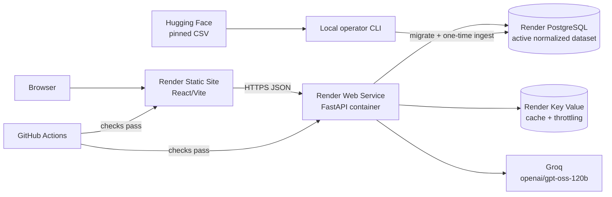

# Production deployment plan

Plan date: 2026-10-23. Platform facts below were verified against linked vendor documentation on this date. Values assigned in the dashboard, actual database size, and account-specific quotas are assumptions until a deployment is performed.

## Recommendation

For the student milestone, deploy the entire existing topology on Render from `render.yaml`:

This preserves the existing architecture. Separating the static frontend from the API avoids spending API memory/CPU on static assets and lets the frontend remain available while a free API wakes from sleep.

## Platform comparison

| Platform | Fit | Free/current constraint | Decision |
|---|---|---|---|
| Render | Native/static/Docker services plus managed PostgreSQL and Redis-compatible Key Value; Blueprint IaC | Free API sleeps after 15 idle minutes; 750 workspace hours/month; free Postgres is 1 GB, expires after 30 days, and has no backups; free Key Value is 25 MB and non-persistent | **Recommended for the short milestone demo** because one provider can represent the current topology at $0 initially |
| Railway | Docker, PostgreSQL, Redis, variables, volumes, and simple monorepo deployments | Current Free plan provides $1/month resource credit; Hobby is a $5/month minimum with $5 usage included; usage above allowance is billed | Strong alternative if a small predictable payment is acceptable; simpler durable path than recreating a Render free DB monthly |
| Vercel | Excellent Vite static/CDN hosting, previews, and Git integration | Hobby is personal/non-commercial and has function/runtime quotas; it does not supply the repository's PostgreSQL/Redis topology | Optional frontend-only alternative; adds a second provider without solving backend state |

Sources: [Render free-tier limitations](https://render.com/docs/free), [Render Blueprint reference](https://render.com/docs/blueprint-spec), [Railway plans](https://docs.railway.com/pricing/plans), [Vercel Hobby plan](https://vercel.com/docs/plans/hobby).

## Frontend deployment

- Service: Render Static Site rooted at `apps/web`.
- Build: `npm ci && npm run build`.
- Publish: `apps/web/dist` (the Blueprint root makes this `./dist`).
- Set `VITE_API_BASE_URL` to the final API origin, for example `https://nextleap-api.onrender.com`, with no trailing `/api`.
- `VITE_API_TIMEOUT_MS=20000` provides a bounded browser request.
- SPA rewrite and security headers are declared in `render.yaml`.
- No secret may use a `VITE_*` name; Vite embeds these values in public JavaScript.

## Backend deployment

- Service: Render Docker Web Service from `apps/api/Dockerfile` with one worker on the 512 MB free instance.
- `/health/live` is the platform deploy health check so the first deploy can succeed before dataset ingestion. `/health/ready` is the traffic/readiness check and returns 503 until PostgreSQL, required Redis, and an active dataset are available.
- `RUN_MIGRATIONS=true` applies idempotent Alembic migrations in the single-instance start script. On paid multi-instance compute, move migrations to Render's paid pre-deploy command and set `RUN_MIGRATIONS=false` to prevent concurrent migration attempts.
- The start script honors Render's `PORT`, defaults to one worker, and allows 20 seconds for graceful shutdown.
- Pool size is reduced to 3 plus 2 overflow for the small demo database. Recalculate total connections before scaling workers/instances.

## Dataset strategy

1. Never ingest in an HTTP request or on every API boot.
2. Run migration and pinned-source ingestion once from a trusted operator machine using the Render database's **external** URL.
3. The adapter downloads in chunks, verifies SHA-256, parses row-by-row, excludes reviews/menu/phone from serving tables, and activates a validated immutable version.
4. Verify `nextleap-data list`, `/health/ready`, database storage consumption, and representative queries.
5. Retain the previous validated version for rollback. For the free 1 GB database, verify that active plus retained versions fit; do not assume they do.
6. A separately packaged normalized artifact would reduce repeated preprocessing, but publishing one is deferred until source licensing is resolved. PostgreSQL remains the serving artifact.

## LLM configuration

Groq currently lists `openai/gpt-oss-120b` as a production model at $0.15/million input tokens and $0.60/million output tokens, with JSON modes and a 131,072-token context. The published free table currently shows the milestone constraints of 30 RPM, 1,000 RPD, 8,000 TPM, and 200,000 TPD. Exact organization limits must be verified in the Groq console. Sources: [Groq supported models](https://console.groq.com/docs/models), [model page](https://console.groq.com/docs/model/openai/gpt-oss-120b), and [rate limits](https://console.groq.com/docs/rate-limits).

Use `LLM_PROVIDER=groq`, `LLM_MODEL=openai/gpt-oss-120b`, `LLM_REASONING_EFFORT=low`, `MAX_LLM_CANDIDATES=12`, and `MAX_LLM_OUTPUT_TOKENS=700`. The API key is server-only. Cached identical responses avoid provider calls. Rate limits, timeout, retry, circuit break, output validation, and deterministic fallback are already implemented.

## Environment variables

| Variable | Location | Secret | Purpose |
|---|---|---:|---|
| `DATABASE_URL` | API/operator | Yes | PostgreSQL; Blueprint injects managed connection string |
| `REDIS_URL` | API | Yes | Render Key Value connection string |
| `LLM_API_KEY` | API | Yes | Groq credential |
| `APP_ENV=production` | API | No | Enables production validation |
| `WEB_ORIGIN` | API | No | Comma-separated exact frontend origins |
| `TRUSTED_HOSTS` | API | No | Comma-separated API hostnames, no scheme |
| `TRUST_PROXY_HEADERS=true` | API | No | Use Render's forwarded client chain for quotas |
| `REDIS_REQUIRED=true` | API | No | Include Redis in readiness |
| `LLM_PROVIDER`, `LLM_MODEL` | API | No | Provider and milestone model |
| `LLM_REASONING_EFFORT` | API | No | GPT-OSS token/latency control |
| `MAX_LLM_CANDIDATES`, `MAX_LLM_OUTPUT_TOKENS` | API | No | Prompt and output bounds |
| `RUN_MIGRATIONS` | API | No | Free single-instance migration strategy |
| `WEB_CONCURRENCY` | API | No | Uvicorn workers |
| `VITE_API_BASE_URL` | Frontend build | Public | Final API HTTPS origin |
| `VITE_API_TIMEOUT_MS` | Frontend build | Public | Browser timeout |

All other tunables are documented in `.env.example`.

## CI/CD

GitHub Actions is the test/security gate. Render's Blueprint uses `autoDeployTrigger: checksPass`, so main-branch deployments follow successful repository checks. Protect `main`, require the `api`, `web`, `repository`, and `security` jobs, and keep production secrets only in Render/Groq—not GitHub unless a later workflow explicitly needs them.

For free compute, schema migration in startup is acceptable only because there is one instance. For a paid production upgrade, use expand/contract migrations, Render's pre-deploy command, managed backups/PITR, and a staging environment.

## Deployment sequence

1. Confirm dataset permission and create a clean Git commit; push it to GitHub.
2. Run every command in the pre-deployment section of `DEPLOYMENT.md`.
3. In Render, create a Blueprint from `render.yaml` and provide the prompted URLs/key.
4. Wait for PostgreSQL, Key Value, API, and static site creation.
5. Copy the database external URL locally, normalize is automatic, run migrations, then execute the exact pinned ingestion command in `DEPLOYMENT.md`.
6. Confirm `/health/ready` changes from 503/not-ready to 200/ready.
7. Run live metadata, no-match, deterministic fallback, normal recommendation, mobile, security-header, and secret-exposure checks.
8. Warm the API shortly before the demonstration; do not use artificial keep-alive traffic to evade platform policy.

## Verification and acceptance

- GitHub CI is green on the deployed commit.
- API liveness is 200; readiness is 200 and reports database available, Redis available, and active dataset true.
- The frontend's network log contains only the public API origin and no secrets.
- Locations/cuisines load; cuisine/budget/rating remain optional per schema; filters and no-match behavior are correct.
- A forced invalid Groq key in staging yields grounded `mode=fallback`, not invented data or an HTTP crash; restore the key afterward.
- Returned IDs exist in the active dataset and restaurant facts match PostgreSQL.
- Desktop/mobile and keyboard smoke tests pass.
- Free PostgreSQL usage is below 1 GB with the chosen retained-version count.

## Rollback

1. In Render, roll back the web/API service to one of the two previous free-tier deploys, or redeploy a known-good Git commit.
2. If the fault is data-only, run `nextleap-data list`, inspect the prior version, then `nextleap-data activate <uuid>`; activation is transactional and changes cache keys.
3. If a forward migration is compatible, leave it in place while rolling application code back. Destructive schema rollback requires a tested backup and explicit approval.
4. Restore prior environment-variable values from the secret manager/dashboard history, never from chat or source control.
5. Re-run readiness and the smoke checklist before restoring demo traffic.

## Costs and constraints

- **Short demonstration assumption:** $0 Render resources and $0 Groq if all free allowances are available and usage stays below limits.
- Render free PostgreSQL expires after 30 days, has 1 GB storage, and has no backups. This makes it a disposable demo database, not durable production.
- Render's free web service sleeps after 15 idle minutes and can take about one minute to wake. Static hosting does not sleep.
- Railway's current Free plan offers only $1/month of resource credit; Hobby is at least $5/month and may exceed that with usage.
- Groq paid usage at the published GPT-OSS price is low for compact prompts, but actual cost depends on measured input/output tokens and retries. Set console alerts and validate organization limits.
- Paid Render pricing is intentionally not hardcoded here; select current plans in the dashboard only after the free demo proves measured memory, storage, connections, and traffic.

## Verified facts versus assumptions

Verified: repository stack/behavior, current vendor documentation linked above, current Groq model listing/rate table, local automated results in `docs/deployment-validation.md`.

Assumptions pending deployment: service names are available, free resources are available in the account/region, normalized data fits 1 GB, source use is authorized, actual Groq account quotas match the public base table, live latency is acceptable, and platform-generated URLs match the values entered for CORS/trusted hosts.
